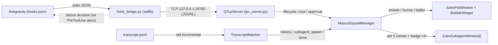

# Plano Mestre de Implementação — Jules Desktop Pet + Antigravity Bridge + OctoSwarm

> **For agentic workers:** REQUIRED SUB-SKILL: Use `superpowers:subagent-driven-development` (recommended) or `superpowers:executing-plans` to implement this plan task-by-task. Steps use checkbox (`- [ ]`) syntax for tracking.

**Goal:** Evoluir o protótipo `jules_pet` para um projeto open-source completo com sprite anatômico fiel ao polvinho do `jules.google` (`24×22`, 4 tentáculos), ponte em tempo real com o Antigravity via hooks oficiais + watcher de `transcript.jsonl`, paridade de personalidade/sessão com o Claude Code (`Clawd` + `/buddy` + `Masko`), e orquestração multi-instância de subagentes (**OctoSwarm**).

**Architecture:** Arquitetura híbrida 100% resiliente baseada em superfícies oficiais do Antigravity (zero dependência de engenharia reversa frágil em binário Electron): um **Plugin do Antigravity** (`plugins/jules-pet-bridge/`) com `hooks.json` executa `hook_bridge.py` (Python stdlib puro, latência < 20ms) comunicando via **TCP Loopback (`127.0.0.1:18765`)** JSON-Lines com um `QTcpServer` no `jules_pet`, complementado por um **Transcript Watcher** que faz *tail* em `transcript.jsonl` para extrair pressão de contexto (`input_tokens + cache_read_tokens`) e ciclo de vida de subagentes (`invoke_subagent` → `SYSTEM_MESSAGE`). No desktop, o `MascotSquadManager` coordena a janela principal (`JulesPetWindow`), o micro-balão QSS (`BubbleWidget`) e até 5 clones coloridos (`JulesSubagentWindow`).

**Tech Stack:** Python 3.13+, `PySide6 >= 6.12.0`, `uv`, `pytest` (`QT_QPA_PLATFORM=offscreen`), `QTcpServer` / `QTcpSocket`, `socket` stdlib (no hook).

---

## Descoberta Técnica & Decisões Arquiteturais Travadas

### 1. Mapeamento Oficial do Antigravity vs. Lacunas
| Capacidade | Suporte Oficial no Antigravity | Como o `jules_pet` Consome |
| :--- | :--- | :--- |
| Ciclo de vida (`idle`, `thinking`, `done`, `error`) | Hooks `SessionStart`, `PreInvocation`, `PostInvocation`, `Stop` (`terminationReason`, `fullyIdle`) | `hooks.json` → `hook_bridge.py` → TCP `lifecycle` |
| Uso de ferramentas (`read/search`, `edit/write`, `terminal`) | Hooks `PreToolUse` / `PostToolUse` (`matcher: "*"`, `toolCall.name`, `args`, `error`) | `hooks.json` → `hook_bridge.py` → TCP `tool_start` / `tool_end` |
| Aprovação bidirecional (`[Permitir]` / `[Bloquear]`) | `PreToolUse` síncrono aceita `{"decision": "allow" \| "deny" \| "ask" \| "force_ask", "reason": "..."}` | Opcional na bandeja (desligado por padrão); quando ligado, intercepta `run_command` com fallback `ask` em timeout |
| Pressão de contexto / tokens | `PLANNER_RESPONSE` em `transcript.jsonl` expõe `input_tokens` e `cache_read_tokens` (`transcriptPath` vem em todo hook) | `TranscriptWatcher` faz *tail* incremental no `transcriptPath` |
| Ciclo de vida de subagentes (`OctoSwarm`) | `transcript.jsonl` registra `invoke_subagent` (`Role`, `TypeName`, `conversationId`) e `SYSTEM_MESSAGE` (`sender=<id>`) | `TranscriptWatcher` correlaciona spawn e conclusão em tempo real |
| Empacotamento GitHub | Estrutura nativa de plugin (`plugin.json`, `hooks.json`, `README.md`) | `plugins/jules-pet-bridge/` pronto para copiar/instalar |

### 2. Decisões Confirmadas no Brainstorming
1. **Transporte IPC:** TCP Loopback `127.0.0.1:18765` (configurável via `JULES_PET_PORT`), protocolo JSON-Lines.
2. **Grade do Sprite:** **`24×22`** pixels lógicos (cúpula larga achatada fiel ao `jules.google`, **4 tentáculos distintos**, recolorização dinâmica por matiz/Hue com cache LRU).
3. **Aprovação Bidirecional:** **Opcional na bandeja** (inicia em modo observador; ao ativar, intercepta `run_command` no balão com fallback seguro `{"decision": "ask"}` se expirar o timeout).
4. **OctoSwarm:** Até **5 clones visíveis** simultâneos (excedentes agrupados em badge `+N` no balão principal) + modo **click-through** (`WindowTransparentForInput`) ativável via bandeja e atalho global.
5. **Áudio:** Estritamente **sem som** — apenas feedback e partículas visuais.

---

## Global Constraints

- **Python & Dependências:** Python 3.13+, gerenciamento exclusivo via `uv` (`uv add`, `uv run`). Proibido `pip install` global.
- **Zero dependências no hook:** `plugins/jules-pet-bridge/scripts/hook_bridge.py` usa apenas biblioteca padrão do Python (`sys`, `json`, `os`, `socket`) para iniciar em < 20ms.
- **Fail-open garantido:** Se o `jules_pet` estiver fechado ou inacessível, `hook_bridge.py` encerra em <= 100ms retornando `{}` (ou `{"decision": "ask"}` em `PreToolUse`).
- **Verificação headless:** Toda fase deve manter `QT_QPA_PLATFORM=offscreen uv run pytest -v` 100% verde.
- **Estilo visual (`design-taste-frontend`):** Balões e menus em QSS dark-indigo sólido (`#1A1033`), borda nítida `#705BD6`, tipografia `Segoe UI` limpa, micro-interações táteis de hover/press nos botões `[Permitir]` e `[Bloquear]`, sem gradientes genéricos.

## Review Focus

1. **Pet offline ou porta ocupada:** `hook_bridge.py` deve fazer *fail-open* em <= 100ms sem travar o loop do Antigravity. (Testado na Fase 3)
2. **JSON malformado ou truncado no TCP / `transcript.jsonl`:** `ipc_protocol.py` e `transcript_watcher.py` devem ignorar linhas corrompidas sem lançar exceção não tratada. (Testado na Fase 2)
3. **Timeout de aprovação `[Permitir]` / `[Bloquear]`:** Se o usuário não responder em `JULES_APPROVAL_TIMEOUT` (ex.: 20s, menor que o timeout de 30s do hook), o servidor devolve `{"decision": "ask"}` para a UI do Antigravity assumir. (Testado na Fase 2 e Fase 4)
4. **Explosão de subagentes (>5) ou subagente órfão:** `MascotSquadManager` deve limitar clones visíveis a 5 + badge `+N` e limpar clones pendentes quando receber `Stop` (`fullyIdle: true`). (Testado na Fase 5)
5. **Click-through ativo:** Com `WindowTransparentForInput` ativado no pet, o usuário ainda consegue desativá-lo pelo `QSystemTrayIcon` ou atalho global. (Testado na Fase 5)

---

## Arquitetura & Contratos IPC

### Contrato JSON-Lines (TCP `127.0.0.1:18765`)
Cada mensagem é uma linha JSON terminada em `\n`:
- **Lifecycle:** `{"type": "lifecycle", "event": "SessionStart|PreInvocation|PostInvocation|Stop", "conversation_id": "...", "termination_reason": "...", "fully_idle": true}`
- **Tool Start / End:** `{"type": "tool_start", "call_id": "...", "tool": "run_command", "category": "terminal|read_search|edit_write|browser|other", "summary": "..."}` / `{"type": "tool_end", "call_id": "...", "tool": "...", "ok": true, "error": ""}`
- **Approval Request → Response:**
  - Hook → Pet: `{"type": "approval_request", "request_id": "...", "tool": "run_command", "command": "npm test", "timeout_ms": 20000}`
  - Pet → Hook: `{"type": "approval_response", "request_id": "...", "decision": "allow|deny|ask", "reason": "..."}`
- **Context & Subagents (internos do `TranscriptWatcher`):**
  - `ContextMetrics(input_tokens, cache_read_tokens, pressure_ratio)`
  - `SubagentEvent(kind="spawn|done", subagent_id, role, type_name)`

---

## Fases Atômicas de Execução

### Fase 0 — Higiene do Repositório e Worktree Isolado

**Files:**
- Remove: `.md` (vazio), `src/` (vazio do `uv init`)
- Keep/Commit: estado atual funcional de `jules_pet/`, `main.py`, `tests/`, `pyproject.toml`, `README.md`, `start_jules.bat`, `.gitignore`

- [ ] **Step 1: Limpar artefatos vazios e criar commit base na `master`**
  - Remover `.md` e `src/` se vazios, fazer `git add` e `git commit -m "chore: initial Jules desktop pet baseline"`.
- [ ] **Step 2: Criar worktree isolado (`using-git-worktrees`)**
  - Criar branch `feat/antigravity-octoswarm` em worktree isolado e validar `QT_QPA_PLATFORM=offscreen uv run pytest -v` verde antes de iniciar as Fases 1–3.

---

### Fase 1 — Motor de Sprites `24×22` + Recolorização Dinâmica

**Files:**
- Modify: `jules_pet/config.py`
- Modify: `jules_pet/sprites.py`
- Create: `tests/test_sprites.py`

**Interfaces:**
- Consumes: `jules_pet/config.py` (`GRID_WIDTH=24`, `GRID_HEIGHT=22`, paleta base)
- Produces: `get_sprite_pixmap(frame_name, eye_mode, eye_dx=0, eye_dy=0, scale=4, flip_x=False, hue_shift=0.0) -> QPixmap`, `recolor_palette(hue_shift: float) -> dict[str, QColor]`, `create_tray_icon() -> QIcon`

- [ ] **Step 1: Escrever testes que falham em `tests/test_sprites.py`**
  - Testar dimensões `24 * scale × 22 * scale`, transparência dos cantos (`alpha == 0`), presença de 4 tentáculos na linha inferior da silhueta, todas as expressões (`normal`, `blink`, `happy`, `surprised`, `sleep`, `thinking`, `coding`, `scanning`, `annoyed_side_eye`, `shocked_ink`, `high_five`, `approval_waiting`) e variação real de cor quando `hue_shift != 0.0`.
- [ ] **Step 2: Rodar `QT_QPA_PLATFORM=offscreen uv run pytest tests/test_sprites.py -v` (esperar FAIL)**
- [ ] **Step 3: Atualizar `GRID_WIDTH=24`, `GRID_HEIGHT=22` em `jules_pet/config.py` e redesenhar `jules_pet/sprites.py`**
  - Cúpula larga achatada com contorno `#E6DCFF`, highlight `#9B87F5`, sombra `#4E39A8`, 4 tentáculos articulados (`idle_0..3`, `walk_0..1`, `drag_0..1`, `coding_0..1`, `high_five_0..1`, `sleep_0`), 12 expressões faciais e `recolor_palette(hue_shift)` via `QColor.fromHsvF` mantendo cache LRU.
- [ ] **Step 4: Rodar `QT_QPA_PLATFORM=offscreen uv run pytest tests/test_sprites.py -v` (esperar PASS)**
- [ ] **Step 5: Commit (`feat: redesign 24x22 4-tentacle Jules sprites with hue recoloring`)**

---

### Fase 2 — Protocolo & Servidor IPC Local + Watcher de `transcript.jsonl`

**Files:**
- Create: `jules_pet/ipc_protocol.py`
- Create: `jules_pet/ipc_server.py`
- Create: `jules_pet/transcript_watcher.py`
- Create: `tests/test_ipc.py`

**Interfaces:**
- Consumes: `jules_pet/config.py` (`IPC_HOST="127.0.0.1"`, `IPC_PORT=18765`)
- Produces:
  - `parse_ipc_message(raw_line: str) -> dict | None` e `categorize_tool(tool_name: str) -> str`
  - `JulesIpcServer(QObject)` com sinais `event_received(dict)`, `approval_requested(str, str, str)` e método `resolve_approval(request_id: str, decision: str, reason: str = "")` (com timer de fallback `"ask"`)
  - `TranscriptWatcher(QObject)` com `set_transcript_path(path: str)`, `poll()`, sinais `context_updated(int, int, float)` e `subagent_event(str, str, str, str)` (`kind`, `subagent_id`, `role`, `type_name`)

- [ ] **Step 1: Escrever testes que falham em `tests/test_ipc.py`**
  - Testar parser de linhas válidas e inválidas (JSON corrompido não quebra), round-trip TCP real via `QTcpSocket` → `JulesIpcServer`, timeout automático de `approval_request` devolvendo `"ask"`, e `TranscriptWatcher` lendo linhas incrementais com `PLANNER_RESPONSE` (`input_tokens` + `cache_read_tokens`), `invoke_subagent` e `SYSTEM_MESSAGE` (`sender=<id>`).
- [ ] **Step 2: Rodar `QT_QPA_PLATFORM=offscreen uv run pytest tests/test_ipc.py -v` (esperar FAIL)**
- [ ] **Step 3: Implementar `ipc_protocol.py`, `ipc_server.py` e `transcript_watcher.py`**
- [ ] **Step 4: Rodar `QT_QPA_PLATFORM=offscreen uv run pytest tests/test_ipc.py -v` (esperar PASS)**
- [ ] **Step 5: Commit (`feat: add loopback QTcpServer IPC and transcript.jsonl watcher`)**

---

### Fase 3 — Plugin Oficial do Antigravity (`plugins/jules-pet-bridge/`)

**Files:**
- Create: `plugins/jules-pet-bridge/plugin.json`
- Create: `plugins/jules-pet-bridge/hooks.json`
- Create: `plugins/jules-pet-bridge/scripts/hook_bridge.py`
- Create: `plugins/jules-pet-bridge/README.md`
- Create: `tests/test_hook_bridge.py`

**Interfaces:**
- Consumes: contrato JSON-Lines da Fase 2 (`127.0.0.1:18765`, `JULES_PET_PORT`, `JULES_PET_APPROVAL_BRIDGE=0|1`)
- Produces: plugin autônomo instalável em `~/.gemini/config/plugins/jules-pet-bridge/` ou `.agents/plugins/jules-pet-bridge/`

- [ ] **Step 1: Escrever testes que falham em `tests/test_hook_bridge.py`**
  - Testar `hook_bridge.py` com pet offline (retorna `{}` ou `{"decision": "ask"}` em < 150ms sem erro), envio de `PostToolUse` / `Stop` para um `socket` TCP mock, e modo `PreToolUse` recebendo `{"decision": "allow"}` do servidor mock.
- [ ] **Step 2: Rodar `uv run pytest tests/test_hook_bridge.py -v` (esperar FAIL)**
- [ ] **Step 3: Criar `plugin.json`, `hooks.json` (`SessionStart`, `PreInvocation`, `PreToolUse` matcher `*`, `PostToolUse` matcher `*`, `PostInvocation`, `Stop`), `scripts/hook_bridge.py` (stdlib puro) e `README.md`**
- [ ] **Step 4: Rodar `uv run pytest tests/test_hook_bridge.py -v` (esperar PASS)**
- [ ] **Step 5: Commit (`feat: add Antigravity jules-pet-bridge plugin`)**

---

### Fase 4 — Paridade Claude Code (`Clawd` + `/buddy` + `Masko`)

**Files:**
- Create: `jules_pet/buddy.py`
- Create: `jules_pet/bubble_widget.py`
- Modify: `jules_pet/physics.py`
- Create: `tests/test_buddy.py`

**Interfaces:**
- Consumes: `ipc_protocol` events + `ContextMetrics`
- Produces:
  - `BuddySessionModel`: controla `mood`, `energy`, `context_pressure` (`0.0..1.0`), `status_verb` bem-humorados por categoria de ferramenta, partículas de suor/tinta quando `pressure >= 0.75`
  - `BubbleWidget(QWidget)`: micro-balão flutuante QSS dark-indigo com texto de status, badge `+N` opcional de fila do enxame, e barra de aprovação `[Permitir]` / `[Bloquear]` com sinal `approval_decided(str, str)`

- [ ] **Step 1: Escrever testes que falham em `tests/test_buddy.py`**
  - Testar mapeamento de eventos (`tool_start`, `tool_end` com erro → `shocked_ink`, `Stop` → `done`), variação de humor/energia com tempo de sessão, acertos, erros e carinhos, geração de `sweat`/`ink` em alta pressão de contexto, e emissão de sinal ao clicar em `[Permitir]` / `[Bloquear]` no `BubbleWidget`.
- [ ] **Step 2: Rodar `QT_QPA_PLATFORM=offscreen uv run pytest tests/test_buddy.py -v` (esperar FAIL)**
- [ ] **Step 3: Implementar `buddy.py`, `bubble_widget.py` e integrar expressões/partículas em `physics.py`**
- [ ] **Step 4: Rodar `QT_QPA_PLATFORM=offscreen uv run pytest tests/test_buddy.py -v` (esperar PASS)**
- [ ] **Step 5: Commit (`feat: add buddy session model and QSS status/approval bubble`)**

---

### Fase 5 — OctoSwarm Multi-Instância & Click-Through

**Files:**
- Create: `jules_pet/subagent_window.py`
- Create: `jules_pet/swarm_manager.py`
- Modify: `jules_pet/pet_window.py`
- Modify: `main.py`
- Create: `tests/test_swarm.py`

**Interfaces:**
- Consumes: `JulesIpcServer`, `TranscriptWatcher`, `BuddySessionModel`, `BubbleWidget`, `get_sprite_pixmap(hue_shift=...)`
- Produces:
  - `JulesSubagentWindow(QWidget)`: clone colorido com spawn elástico, movimento lúdico próximo ao Jules principal, voo até o principal + animação `high_five` visual (sem som) + `fade-out` ao concluir
  - `MascotSquadManager(QObject)`: gerencia até 5 clones visíveis + contador `overflow_count` (`+N`), aciona `annoyed_side_eye` no Jules principal ao spawnar clones, faz cleanup em `Stop(fullyIdle=True)`, e aplica `set_click_through(enabled: bool)` (`Qt.WidgetAttribute.WA_TransparentForInput`) em todas as janelas + atalho global `Ctrl+Shift+J` (com fallback seguro na bandeja)

- [ ] **Step 1: Escrever testes que falham em `tests/test_swarm.py`**
  - Testar spawn de 7 subagentes (exatamente 5 janelas criadas + `overflow_count == 2`), `hue_shift` distintos por clone, expressão `annoyed_side_eye` no principal ao spawnar, transição para `high_five` + remoção em `subagent_done`, cleanup de órfãos em `Stop(fullyIdle=True)`, e propagação de `WA_TransparentForInput` em todas as janelas.
- [ ] **Step 2: Rodar `QT_QPA_PLATFORM=offscreen uv run pytest tests/test_swarm.py -v` (esperar FAIL)**
- [ ] **Step 3: Implementar `subagent_window.py`, `swarm_manager.py`, atualizar `pet_window.py` (menu da bandeja: *Aprovação pelo Pet*, *Modo Click-Through*) e `main.py`**
- [ ] **Step 4: Rodar `QT_QPA_PLATFORM=offscreen uv run pytest tests/test_swarm.py -v` (esperar PASS)**
- [ ] **Step 5: Commit (`feat: add OctoSwarm multi-agent orchestration and click-through`)**

---

### Fase 6 — Verificação Ponta-a-Ponta, Smoke Test Real e Fechamento GitHub

**Files:**
- Modify: `README.md` (documentar instalação do plugin + atalhos + OctoSwarm)
- Verify: `tests/` completa + smoke test real TCP

- [ ] **Step 1: Rodar suíte completa headless**
  - `QT_QPA_PLATFORM=offscreen uv run pytest -v` → 100% PASS, 0 skipped.
- [ ] **Step 2: Smoke test real da ponte IPC (`hook_bridge.py` → `JulesIpcServer` → `MascotSquadManager`)**
  - Subir `JulesPetWindow` + `MascotSquadManager` em modo offscreen e disparar eventos reais via `hook_bridge.py` em subprocesso (`SessionStart`, `PreToolUse`, `PostToolUse`, `Stop`), confirmando transição de estado e saída limpa.
- [ ] **Step 3: Atualizar `README.md` e executar revisão final (`requesting-code-review` + `finishing-a-development-branch`)**

---

## Mapa de Skills para a Fase de Execução

| Quando Usar | Skill | Papel na Execução |
| :--- | :--- | :--- |
| Início da Fase 0 | `using-git-worktrees` | Isolar desenvolvimento em worktree limpo |
| Toda adição/execução Python | `managing-python-dependencies` | Garantir uso exclusivo de `uv`, zero `pip` global |
| Fases 1, 2 e 3 (independentes!) | `dispatching-parallel-agents` + `subagent-driven-development` | Despachar Sprite Engine (F1), IPC/Watcher (F2) e Plugin Bridge (F3) em paralelo |
| Fases 1 a 5 (todos os testes) | `test-driven-development` | Ciclo obrigatório Red → Green → Refactor |
| Fase 3 (`plugins/jules-pet-bridge/`) | `plugin` | Validar manifest `plugin.json` e `hooks.json` na raiz do plugin |
| Se houver falha em Qt/IPC/Hook | `systematic-debugging` | Diagnóstico estruturado antes de tentar correções |
| Fim de cada fase e Fase 6 | `verification-before-completion` | Exigir saída real de `uv run pytest -v` e smoke test antes de concluir |
| Encerramento | `requesting-code-review` + `finishing-a-development-branch` | Revisão final e merge/PR pronto para GitHub |
